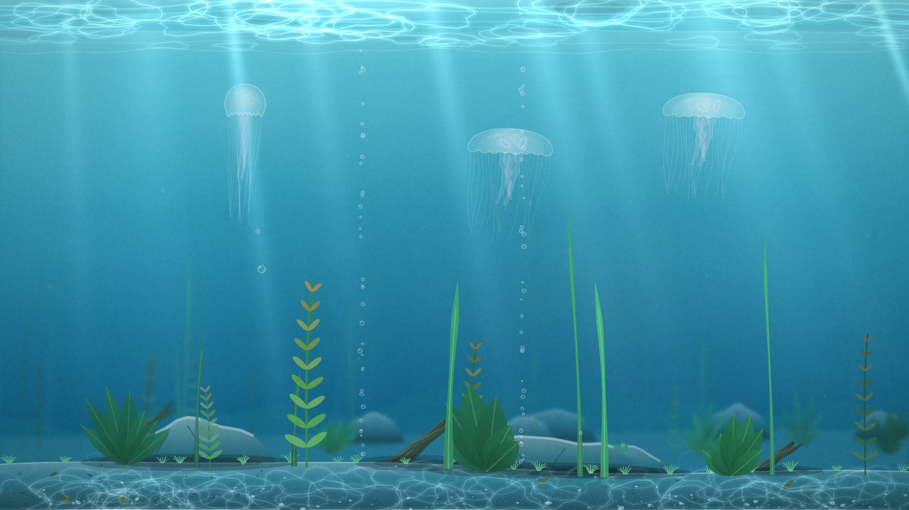

# nagara

作業中に流しておく水草水槽のビジュアルです。音と時間帯に反応します。



## 概要

横から眺める水草水槽を描いたブラウザ用のビジュアルです。魚は登場せず、ミズクラゲ（海月）と、水草・石・泡・光・水そのものを主役にしています。マイクで拾った音に合わせて水槽の中が動き、音がない場合は時間帯に合わせて照明がゆっくり変わります。

## 見どころ

- **海月**: 半透明の傘、4 つの生殖腺、縁の触手、口腕を描いたミズクラゲです。傘を閉じて水を押し出すたびに上へ進み、しばらく泳ぐと傘を広げたまま休んでゆっくり沈みます。光の筋に入ると明るく照らされます。
- **奥行き**: 手前・中間・奥の 3 層に分け、奥のものほど小さく、水の色に溶け込み、ぼやけて見えます。手前にピントが合った写真のような見え方です。
- **水の透明感**: 水中の濁りの雲、遠くの海藻の影、光の散乱、漂う細かな粒（マリンスノー）で、澄んだ水の厚みを表しています。
- **光**: 水面から差し込む光の筋は、横方向にもやわらかくぼけながら深くなるほど弱まります。水面には太陽の光の窓とゆらめく光の網目、底には揺れる光の模様（コースティクス）が映ります。
- **水面**: 下から見上げた水面の波打つ境目、全反射した光、光の窓を描いています。
- **地面**: 起伏のある砂利の底床に、小石、草、落ち葉、流木、苔むした石を配置し、それぞれに接地の影を付けています。
- **水草**: リボン状の葉、茎に葉が付く有茎草、剣状の葉のロゼットの 3 種類が、水流に合わせてそよぎます。
- **泡**: エアストーンから細かい泡が立ち昇ります。
- **質感**: 画面全体にうっすらフィルムの粒状感と周辺減光を重ねています。

## 公開URL

https://0kimuchi0.github.io/nagara/

## 使い方

- ブラウザの全画面表示で流しておくと、作業の邪魔になりにくくなります。
- 初回はクリックすると、マイクを使って音に反応するようになります。ブラウザからマイクの許可を求められたら許可してください。無視しても時間帯の照明に合わせて動きます。
- マウスを動かすと右下に ⚙ メニューが数秒間表示されます。メニューから全画面表示やマイクの切り替えができます。
- `?hour=` を付けると、指定した時刻の照明を確認できます。例えば `https://0kimuchi0.github.io/nagara/?hour=22` は 22 時の照明で表示します。

## 音への反応

- 全体の音量が大きいほど、光の筋が明るくなり、浮遊する光の粒が輝きます。
- 低音が強いと、水草全体が水流に押されたようにそよぎます。
- 高音が多いと、泡が多めに湧き上がります。
- 低音が急に強くなった瞬間は、底から泡がまとまって昇り、光の筋が一瞬ゆらぎます。
- 拍に合わせて、海月が傘をきゅっと閉じてひと押し上に進みます。
- 音量に応じて、海月の傘がほのかに光ります。
- 変化はなめらかに減衰するので、急な明滅は出ません。

## 時間帯

端末の時刻を使い、照明が次のように変わります。境目は約 1 時間かけて切り替わります。

- 朝（5〜10 時）: ライトが少しずつ点き、淡い緑と水色になります。
- 昼（10〜16 時）: 明るく澄んだ青緑になり、光の筋が最もはっきり見えます。
- 夕（16〜19 時）: 暖色の照明になり、水が橙がかります。
- 夜（19〜5 時）: 青い月光ライトになり、全体が暗くなって動きもゆっくりになります。

## 技術構成

- Vite + TypeScript
- 描画は Canvas 2D
- 音の分析は Web Audio API（AnalyserNode）
- 外部ライブラリは使っていません
- テストは Vitest

## 開発

```bash
npm install
npm run dev     # 開発サーバーを起動
npm test        # テストを実行
npm run build   # 型チェックのあとに dist/ を生成
```

`main` ブランチに push すると、GitHub Actions がテストとビルドを行い、GitHub Pages に公開します。
